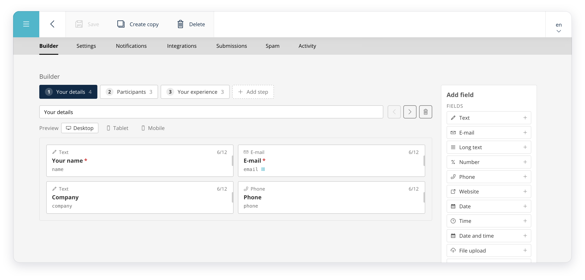

# Sulu Form Builder Bundle

A form builder for Sulu 3, built on Symfony's own form component from top to bottom. Editors build
multi-step forms on a 12-column grid, with conditions, notifications and integrations, and every
submission lands in a readable inbox in the admin.

## What's inside

- [**A visual 12-column builder**](https://sulu.eekes.be/sulu-form-builder-bundle/form-builder): fields sit side by side as they will on the website, with a width per screen size and a modal per field.
- [**Multi-step forms**](https://sulu.eekes.be/sulu-form-builder-bundle/multi-step-forms) on Symfony's native form flow, with repeaters, ratings, dates and times among the [field types](https://sulu.eekes.be/sulu-form-builder-bundle/field-types).
- [**Conditional logic**](https://sulu.eekes.be/sulu-form-builder-bundle/conditions): show fields and steps, send e-mails or run integrations only when nested AND/OR rules match.
- [**Notifications**](https://sulu.eekes.be/sulu-form-builder-bundle/notifications): any number of e-mails per form, in templates that hold up in every mail client, with a live preview and an e-mail log.
- [**Submissions**](https://sulu.eekes.be/sulu-form-builder-bundle/submissions): a readable inbox per form, with the columns you choose.
- [**Integrations**](https://sulu.eekes.be/sulu-form-builder-bundle/integrations): flows to [Mailchimp](https://sulu.eekes.be/sulu-form-builder-bundle/mailchimp), [Teamleader](https://sulu.eekes.be/sulu-form-builder-bundle/teamleader) and [webhooks](https://sulu.eekes.be/sulu-form-builder-bundle/webhooks), with a run log and automatic retries.
- [**Spam protection**](https://sulu.eekes.be/sulu-form-builder-bundle/spam-protection): a honeypot on every form, [reCAPTCHA v3](https://sulu.eekes.be/sulu-form-builder-bundle/recaptcha) as a package, and a Spam tab to release a person caught by mistake.
- [**Extending**](https://sulu.eekes.be/sulu-form-builder-bundle/events): events, and field types, integrations and spam checks of your own as one class each.

How it differs from `sulu/form-bundle`: [the comparison](https://sulu.eekes.be/sulu-form-builder-bundle#compared-to-suluform-bundle).

## Documentation

[Installation](https://sulu.eekes.be/sulu-form-builder-bundle/installation), [configuration](https://sulu.eekes.be/sulu-form-builder-bundle/configuration) and everything else: **[sulu.eekes.be/sulu-form-builder-bundle](https://sulu.eekes.be/sulu-form-builder-bundle)**.

## License

MIT
